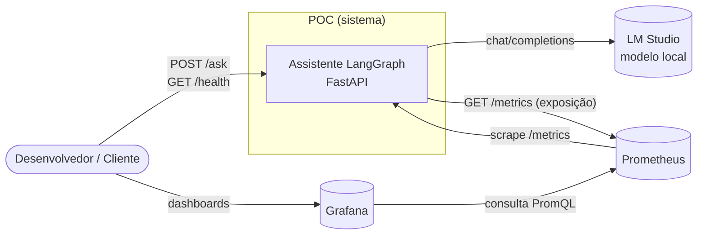
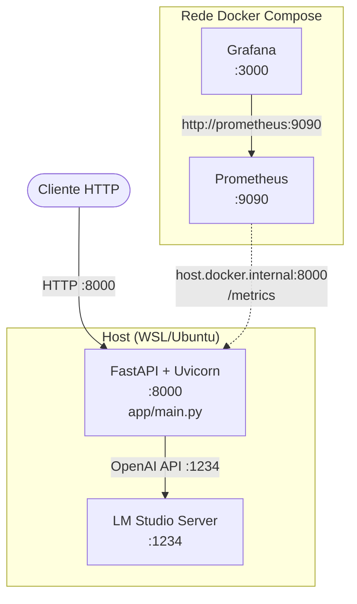
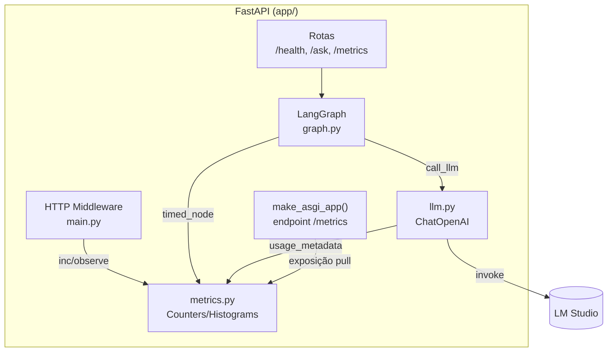
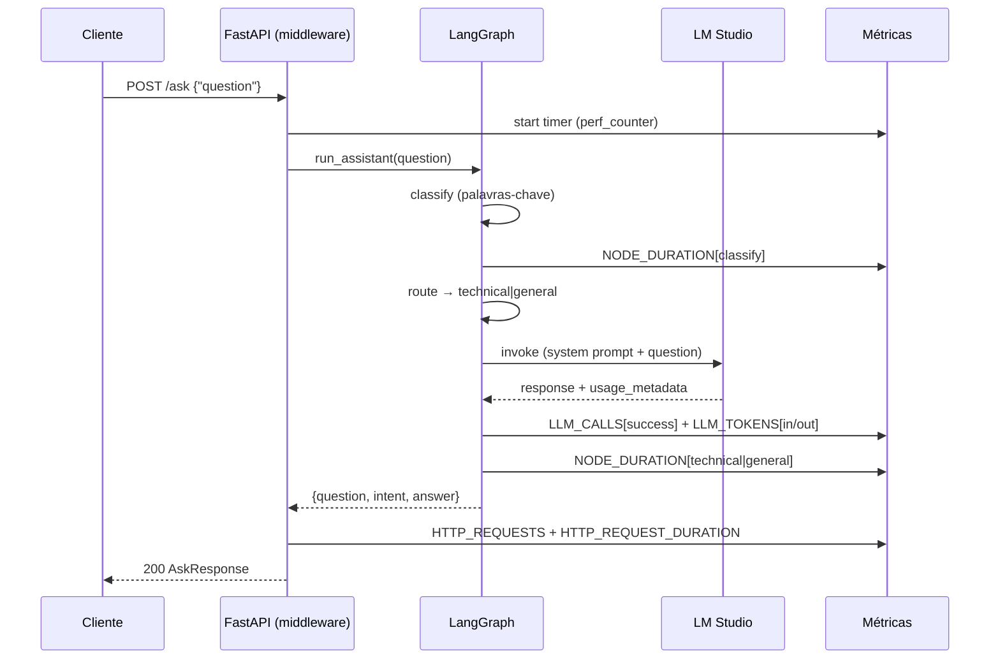
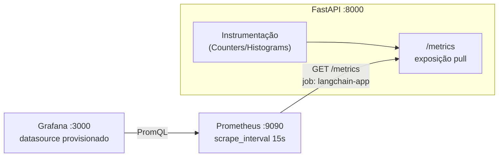
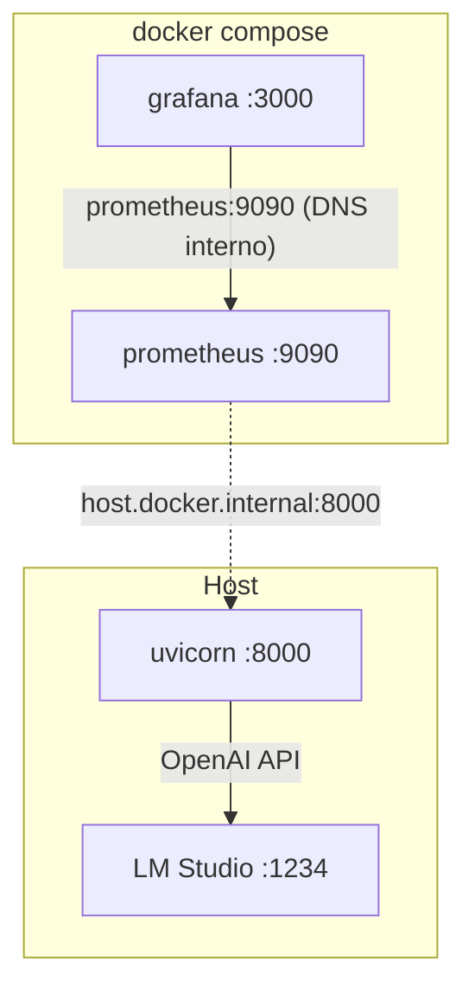

# Arquitetura — LangChain + LangGraph Observability POC

> Documento de arquitetura de referência. Diagramas em [Mermaid](https://mermaid.js.org/) (renderizam no GitHub).

## 1. Visão geral

Assistente conversacional que classifica perguntas (técnica vs. geral) e responde via LLM local (LM Studio). A aplicação é instrumentada com métricas Prometheus e observável no Grafana. Tudo orquestrado por um grafo LangGraph.

**Características-chave**

- LLM 100% local (LM Studio, OpenAI-compatible) — sem dependência de nuvem.
- Orquestração declarativa via LangGraph (state machine).
- Observabilidade pull via Prometheus + Grafana.
- A app roda no host; Prometheus e Grafana rodam em contêineres.

## 2. Diagrama de Contexto (C4 Nível 1)

## 3. Diagrama de Containers (C4 Nível 2)

- `host.docker.internal` (via `extra_hosts: host-gateway`) é a ponte entre os contêineres e a app no host.
- Prometheus e Grafana compartilham a rede default do Compose, então o Grafana resolve `prometheus` por DNS interno.

## 4. Diagrama de Componentes (C4 Nível 3 — App)

## 5. Fluxo de requisição (`POST /ask`)

## 6. Fluxo de métricas (observabilidade)

**Jobs de scrape** (`observability/prometheus.yml`):

- `prometheus` → `localhost:9090` (auto-scrape).
- `langchain-app` → `host.docker.internal:8000/metrics`.

## 7. Topologia de deployment

| Camada        | Onde            | Porta | Observação                                |
|---------------|-----------------|-------|-------------------------------------------|
| FastAPI app   | Host (uvicorn)  | 8000  | Roda fora do Docker; `--reload` em dev    |
| LM Studio     | Host            | 1234  | Modelo OpenAI-compatible; CPU            |
| Prometheus    | Contêiner       | 9090  | Volume `prometheus-data`                  |
| Grafana       | Contêiner       | 3000  | Volume `grafana-data`; datasource prov.   |

## 8. Decisões arquiteturais

| #  | Decisão                                   | Motivo                                                                                  |
|----|-------------------------------------------|-----------------------------------------------------------------------------------------|
| 1  | LLM local via LM Studio                   | POC sem custo de nuvem, dados não saem do host, baixa latência de rede.                 |
| 2  | LangGraph para orquestração               | Estado explícito, roteamento condicional e pontos naturais para instrumentar nodes.     |
| 3  | App no host, obs em contêineres           | `--reload` em dev é simples no host; observabilidade é stateless e cabe em contêiner.   |
| 3a | `host.docker.internal` como ponte        | Único jeito limpo do contêiner alcançar serviço no host (cross-platform).               |
| 4  | Métricas pull (Prometheus)                | Simples, sem agente na app; `/metrics` já vem pronto via `prometheus_client`.           |
| 5  | Provisioning declarativo do Grafana       | DataSource criado automaticamente; sem configuração manual a cada `up`.                |
| 6  | Prefixo `poc_` nas métricas               | Evita colisão com métricas de bibliotecas; fácil de filtrar.                            |
| 7  | `max_tokens=512` no LLM                   | Limita tempo de resposta em CPU (~0.25s/token) abaixo do timeout de 180s.                |
| 8  | Classificação por palavras-chave (sem LLM)| Roteamento determinístico e barato; LLM só no node de resposta.                         |

## 9. Limites e riscos

- **Disponibilidade do LM Studio**: se o servidor cair, `/ask` retorna erro (métrica `llm_calls{status="error"}`).
- **Single-node**: sem réplica nem balanceador; não é arquitetura de produção.
- **Persistência**: sem checkpointing do LangGraph; cada `/ask` é stateless.
- **Segurança**: endpoints sem autenticação; `.env` com chave dummy do LM Studio. Adequado para POC, não para exposição pública.
- **Scrape depende da app no ar**: target `langchain-app` fica DOWN se o uvicorn não estiver rodando.

## 10. Evoluções sugeridas (não implementadas)

- Checkpointing do LangGraph (memória/conversa multi-turno).
- Tracing distribuído (OpenTelemetry + Tempo/Jaeger) — dependências já presentes.
- Conteinerização da app e `docker compose` único.
- Auth no `/ask` (API key) e TLS no uvicorn.
- Alertas no Prometheus (`alertmanager`) e dashboards provisionados via `dashboards/`.
